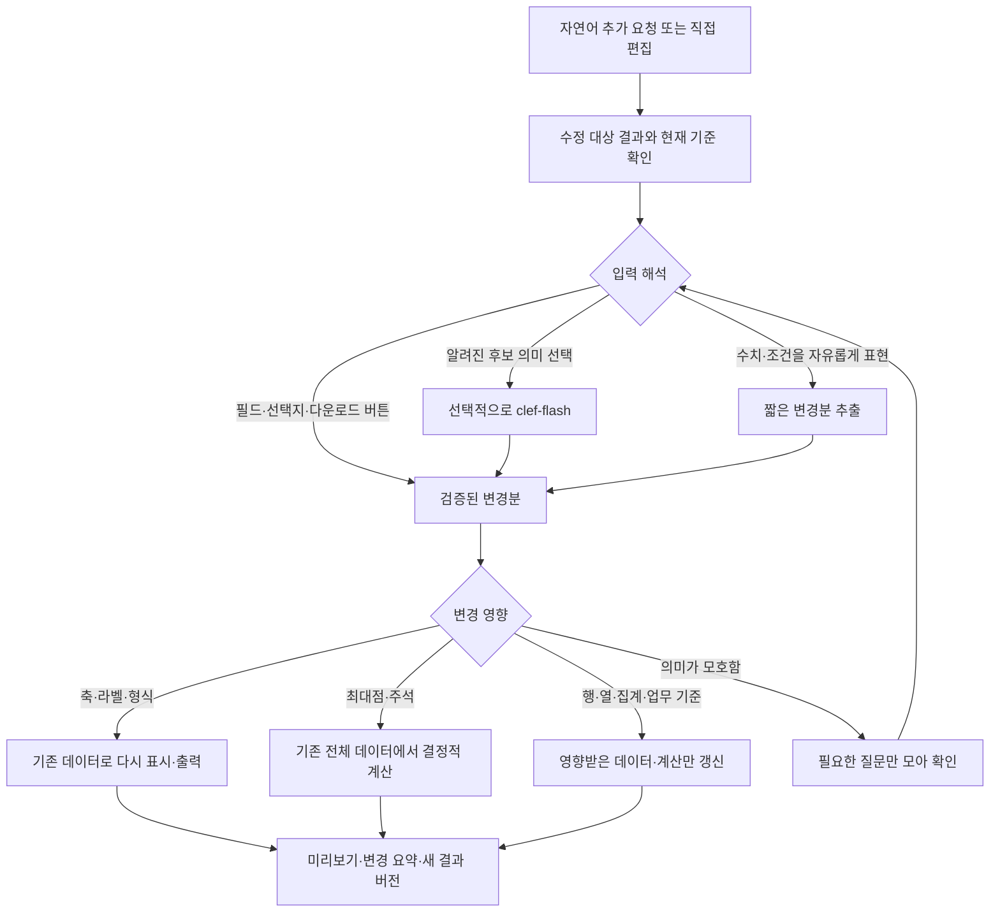

# 엑셀 결과 수정·반복 확인·PNG/PPTX 확장: 원인 분석과 구현 계획

- 작성일: 2026-11-10 (Asia/Seoul)
- 상태: 3.0.20 1차 구현·검증 완료. 원인 분석과 타당성 검토 원문은 보존했으며 최종 구현 범위·검증 결과는 §11을 참조한다.
- 소스 기준: 3.0.19, dev `d6760ba` / 기능 커밋 `22e7825`.
- 근거: 현재 소스, 현재 Mac의 Excel 작업 SQLite 기록, 실제 스키마에 대한 읽기 전용 재현.
- 이전 문서: [EXCEL_WORK_ISSUES_AND_IMPROVEMENT_PLAN.md](EXCEL_WORK_ISSUES_AND_IMPROVEMENT_PLAN.md).
- 타당성 평가: 2026-11-10 소스 대조 결과를 §0에 추가했다. 기존 본문은 지우지 않았고, 일부 절 끝에 `> 타당성 검토` 메모를 붙였다.
- 사용자 확정: PowerPoint는 **그래프 이미지 삽입 + 편집 가능한 제목·설명**이면 충분하다. 출력은 `.pptx`로 한다.

## 0. 구현 타당성 평가 (2026-11-10)

현재 작업 트리 `d6760ba`(3.0.19) 소스와 이 문서의 제안을 하나씩 대조했다. 코드 수정·테스트 실행·모델 호출은 하지 않았다. 평가 기준은 사용자가 정한 세 가지 목표다. 대상은 재무회계·소재개발·인사총무처럼 엑셀 데이터를 자주 가공하는 비개발 구성원이다.

- **(1) 정확하고 빠르게**: 같은 데이터로 같은 숫자가 나오고, 사람이 기다리는 시간이 짧아야 한다.
- **(2) 원하는 결과물 형태**: 축·눈금·라벨·형식(PNG/PPTX 포함)을 사용자가 원하는 대로 지정할 수 있어야 한다.
- **(3) 자연어로 편하게 반복 수정**: 앞서 정한 조건이 유지되고, 바뀐 결과를 바로 확인하며 이어서 고칠 수 있어야 한다.

### 0.1 총평

- 원인 진단(§1~3)은 소스와 일치한다. 인용한 행 번호도 확인한 범위에서 모두 맞다(§0.6).
- 방향(표시 수정은 표시 단계만 다시 실행, 최댓값은 코드로 계산, 같은 렌더링 결과에서 PNG/PPTX, Clef는 기능이 갖춰진 뒤 실험)은 세 목표에 맞고 구현 가능하다.
- 다만 두 가지를 조정할 것을 권장한다.
  1. **필요 이상으로 큰 부분**: §4.2의 결과 snapshot 저장소는 1차 범위에서 빼도 된다. 차트 결과는 이미 남아 있는 `chartRequest`로 결정적으로 다시 계산할 수 있고 실측상 1초 안팎이다(§0.3-2).
  2. **빠진 부분**: 수정 결과를 채팅에서 바로 볼 수 있는 미리보기가 없다. 목표 (3)에 가장 효과가 큰 항목인데 §8에서는 6순위다(§0.3-4). 또 다른 부서에서 흔한 "표·XLSX 양식" 수정은 이 문서 범위 밖이다(§0.3-7).
- 조정안대로 진행하면 TGA 사례(수정 4회, 257초, 실패로 끝남)를 **변경분 추출 모델 1회 + 로컬 처리 2초 안팎**으로 줄이는 1차 결과는 1인 기준 약 1.5~2주로 추정한다. 추출 호출의 실제 응답 시간은 아직 측정하지 않았다.

### 0.2 항목별 판정

| 문서 항목 | 판정 | 기여 목표 | 규모(1인, 테스트 포함 대략) | 위험·비고 |
| --- | --- | --- | --- | --- |
| §3.1 / §4.3 축 범위·눈금·자릿수·최대점 계약과 렌더러 | 타당, 즉시 착수 | (1)(2) | M, 2~3일 | 낮음. `lineChart.ts`는 56행의 앱 코드라 교체 범위가 좁다. 단 축·주석은 `chartSpec`이 아니라 별도 `view`에 두는 것을 권장(§0.3-1) |
| §3.2 / §4.2-1 표시 수정 전용 경로 | 타당, 핵심 | (1)(3) | M, 3~4일 | 중간. 재실행 기반(`chartRequest` 보존, `compileChart` 재출력 경로)이 이미 있다 |
| §3.3 이번 발화 전달·수정 대상·`chartRequest` 보존 | 타당, P0 | (3) | S~M, 1~2일 | 낮음. 수정 대상 run/artifact ID는 IPC 인자 추가로 가능. `business_artifacts.audit` JSON에 결과 revision을 담으면 DB 스키마 변경 없이 시작 가능 |
| §4.1 current criteria / pending / active questions | 방향 타당, 단계 분리 권장 | (3) | 1차 S(차트 `view` + `chartRequest` 누적), 일반화 L | 중간. 일반 코드 경로의 "업무 기준"을 구조화할 스키마가 아직 없다. 1차는 차트 상태만 명시적으로 유지 |
| §4.2-2~5 결과 snapshot 저장소 | 1차 범위에서 보류 권장 | (1) | L, 1~2주 | 높음. 계정별 파일·삭제 정책·hash 검증까지 필요. 결정적 재실행으로 대체 가능(§0.3-2) |
| §5 clef-flash | 보류·실험 동의 | (1) | S~M | `/v1/systemone`은 후보 선택(`choice`)만 검증된 계약이다(`router.ts` 52~106행). 수치 추출에 쓸 근거는 없다 |
| §6 반복 수정 작업 화면 | 타당, 순서 조정 | (3) | 인라인 미리보기 S~M, 전체 작업 영역 L | 미리보기를 PNG 렌더러와 함께 앞당긴다(§0.3-4) |
| §7.2 PNG | 타당 | (2)(3) | S~M, 1~2일 | 낮음. `pdf.ts`의 숨김 BrowserWindow를 재사용해 `capturePage()`로 만들면 PDF와 같은 Chromium 폰트를 쓴다. 숨김 창 캡처·Windows DPI는 확인 필요 |
| §7.3 PPTX (이미지 + 편집 가능한 제목·설명) | 타당 | (2) | M, 2~3일 | 중간. 새 의존성(PptxGenJS, MIT) 추가와 electron-builder 패키징 확인 필요 |
| §7.4 출력 계약 확장 | 타당 | (2) | S, 1일 | `contracts.ts` 5행 enum, `flow.ts` 173·176행의 개수·확장자 검사, `tool.ts` `validateOutput`(PDF/HTML만 허용)을 함께 고친다 |
| §9 테스트·수용 기준 | 타당 | 전체 | — | "표시 수정 시 재계획 0회" 같은 기준은 trace로 바로 검증 가능하다(3.0.19 계측 존재) |

### 0.3 문서에 없던 발견과 조정안

1. **표시 설정을 분석 결과와 분리해야 수정이 빨라진다.** 지금 `chartSpec`은 샌드박스 코드가 반환하는 결과의 일부다. 기본 차트도 `chartPlan.ts` 30행의 고정 코드가 `charts`를 만들고 `validateResult`가 검사한다. 축·주석을 `chartSpec`에 넣으면 눈금만 바꿔도 분석을 다시 돌려야 하고, 일반 코드 경로에서는 모델이 그 필드를 써야 한다. 권장: `chartSpec`은 "어느 열이 X/Y인가"라는 데이터 구조만 맡고, 축 범위·눈금·자릿수·주석·제목·라벨은 `WorkingState`의 별도 `view`에 저장해 렌더 시점에 적용한다. 그러면 표시 수정은 "렌더 + 출력"만 다시 하고, 생성 경로와 수정 경로가 같은 `view` 검증기를 쓴다.
2. **차트 결과는 snapshot 없이 결정적 재실행으로 충분하다.** 완료 checkpoint는 전체 analysis만 버리고 `chartRequest`는 남긴다(`tool.ts` 74~77행). 재출력도 이미 `compileChart`로 다시 계산한다(265~266행). TGA 실측에서 로컬 분석은 0.475~0.528초, HTML+PDF 출력은 0.446~0.494초였다(이전 문서 §11). 1차는 "`chartRequest` + `view` + 원본 fingerprint 확인 → 재실행 → 렌더"로 하고, snapshot은 필요가 확인될 때 도입한다.
   - 일반 코드 결과도 비슷하게 풀 수 있다. 재실행을 막은 이유는 생성 코드의 `Date`/`Math.random` 때문이었다. QuickJS 컨텍스트(`sandbox.ts` 16행)에서 이 둘을 고정값으로 덮으면 같은 입력에 같은 결과가 나온다. 코드는 완료 checkpoint의 `previous.plan.code`에 이미 남아 있다. 재실행 결과를 이전 결과 요약(행 수·min/max)과 대조하면 snapshot 저장소보다 작업량과 위험이 작다.
3. **완료 후 수정마다 새 run이 생기고, 직전 수정 문장은 이어지지 않는다.** `flow.ts` 51행은 새 run의 `revision`을 이번 문장 하나로 초기화하고, `excelState`·`clarifications`만 복사한다. 그래서 "축 수정"(두 번째 run) → "Tmax 추가"(세 번째 run)에서 축 요청은 문장으로 남지 않고 `chartRequest`나 `computed.plan`을 통해서만 이어진다. 현재 `chartRequest`에는 축 필드가 없으니 세 번째 run에서 축 수정이 빠질 수 있다. 수정 내용을 `view`처럼 상태로 누적 저장하는 것이 목표 (3)의 전제 조건이다. §4.1의 current view가 이 문제를 다루지만 P1이 아니라 **P0**로 올려야 한다.
4. **결과를 채팅에서 볼 수 없다.** 완료 메시지는 `reportPreview`의 텍스트이며 차트는 "N개 점" 한 줄로만 나온다(`render.ts` 124행). 결과 영역은 파일 열기·저장 버튼뿐이다(`BusinessToolCard.tsx` 131~156행). 수정할 때마다 파일을 열어 확인해야 하니 자연어 반복 수정이 불편하다. PNG 렌더러가 생기면 같은 이미지를 채팅 미리보기로 보여줄 수 있다. §8의 5·6번 중 "PNG 렌더 + 인라인 미리보기"를 3번째로 당기는 것을 권장한다.
5. **변경분 추출 호출의 입력을 크게 줄일 수 있다.** 지금은 호출마다 SYSTEM+CHART_PLANNING 프롬프트, 프로파일(20,000자 예산), 열람 이력, `computed`를 모두 보낸다(`tool.ts` 354~372행, 실측 17,600~19,100 tokens). 표시 수정 추출에는 현재 `chartRequest`의 열 목록, 현재 `view`, 이번 문장, 허용 스키마만 있으면 된다. 수천 tokens 이하로 줄어 같은 모델에서도 응답이 크게 빨라질 것으로 예상하지만 측정하지 않았다. 추출이 실패하거나 미지원 항목이 있으면 전체 계획 루프로 돌아가지 말고 "지원하지 않는 항목: …"을 바로 안내한다.
6. **표시되는 `v0.4`는 도구 버전이다.** 결과 버튼의 `v{item.version}`(`BusinessToolCard.tsx` 151행)은 `tool.version`이다. 결과 revision은 `business_artifacts`의 `audit` JSON(`flow.ts` 209행)이나 job payload에 넣으면 스키마 변경 없이 시작할 수 있다.
7. **목표 (2)에 중요한 공백(이 문서 범위 밖).** 재무회계·인사총무에서 "원하는 형태"는 대개 표와 XLSX다. 열 순서·이름, 정렬, 소계, 숫자 서식, 회사 양식 같은 것이다. 현재 XLSX 출력은 "분석 안내 / 결과 N / 제외 행 / 차트" 고정 구성이고(`render.ts` 94~119행), 일반 엑셀 작업에는 사용자의 기존 양식에 값을 채우는 경로가 없다(Daily Cash만 `updateSource` 사용). 이 문서의 `view` 분리·변경분 추출·직접 편집 구조는 표에도 그대로 쓸 수 있다. 그러니 `view` 계약을 차트 축에 한정하지 말고 표 표시(열 순서·이름·정렬·숫자 서식·자릿수)까지 같은 틀로 설계해 두기를 권장한다. 양식 채우기는 별도 계획이 필요하다.
8. **정확성의 남은 한계.** Tmax 같은 결정적 계산은 정확도를 높이지만, 일반 업무 계산은 여전히 LLM이 생성한 코드다. 완료 검사도 "결과 형식·원본 행 범위·누락 검사 (계산 정확성 보증 아님)"이다(`tool.ts` 190행). 재무 금액의 decimal 처리 같은 업무별 검증은 §6.3·§9에 원칙만 있고 이번 구현 단위에는 들어 있지 않다.

### 0.4 권장 착수 순서 (§8 대비 조정)

| 순서 | 작업 | 규모 | 근거 |
| --- | --- | --- | --- |
| 1 / P0 | 차트 `view` 계약 + 렌더러(축 min/max/tickStep/tickValues/decimals, 최대점 주석), 실패해도 `chartRequest` 보존, 이번 발화 명시 전달 | 2~3일 | §0.3-1, §3.1, §3.3 |
| 2 / P0 | 표시 수정 경로: 완료 결과에서 `chartRequest`+`view` 복원 → 작은 프롬프트로 변경분 추출 1회 → 결정적 재실행·렌더. 연속 수정 시 `view` 누적 | 3~4일 | §0.3-2·3·5 |
| 3 / P1 | PNG 렌더(숨김 창 `capturePage`) + 채팅 인라인 미리보기 + PNG 출력 계약 | 2~3일 | §0.3-4, §7.2 |
| 4 / P1 | PPTX(PptxGenJS) + 출력 개수·형식 계약 정리 | 2~3일 | §7.3·7.4 |
| 5 / P1 | 결과별 수정 버튼·결과 revision·직전 버전으로 되돌리기, 현재 기준 요약, 질문 중 복합 발화 해석 | 1~2주 | §6, §3.3 |
| 6 / P2 | 일반 코드 결과의 결정적 재실행(Date/random 고정) 또는 snapshot, 일반 current criteria, 표 `view` | 별도 산정 | §0.3-2·7, §4.1·4.2 |
| 7 / 실험 | Clef 후보 선택 | S~M | §5 |

1~3을 묶으면 TGA 수정 시나리오가 끝까지 동작하고, 결과를 채팅에서 바로 확인할 수 있다.

### 0.5 목표별 기대 효과

| 목표 | 조정안 1~4 후 | 남는 공백 |
| --- | --- | --- |
| (1) 정확·빠름 | 표시 수정은 모델 11회·249초에서 추출 1회 + 로컬 약 2초로 줄 것으로 예상. Tmax는 전체 데이터에서 코드로 계산 | 추출 호출 시간 미측정. 일반 계산 코드의 정확성은 그대로 |
| (2) 원하는 형태 | 축·눈금·자릿수·최대점 지정, PNG·PPTX 추가 | 표·XLSX 양식 중심 업무(§0.3-7) |
| (3) 반복 수정 | 수정 누적, 미리보기, 미지원 즉시 안내 | 결과별 수정·되돌리기·복합 발화(5번)는 그 뒤 |

### 0.6 소스 대조 결과

문서가 인용한 위치를 확인했다. `contracts.ts` 5·35·68행, `lineChart.ts` 5·6·31행(눈금 `i<=4`로 5개 고정, `toPrecision(5)`), `tool.ts` 74·283·337·368·465·535·674행, `flow.ts` 48·51·69·95·173행, `clarifications.ts` 최근 12개 상한, `router.ts`의 `/v1/systemone` choice 검증, 의존성(`sharp`·`@hyzyla/pdfium`·`jszip` 있음, PPTX 작성기 없음) 모두 문서 설명과 일치한다. §3.3의 "`flow.ts` 95행 changedKeys가 비어 latestInstruction에서 빠짐"도 맞다. `start()`가 같은 입력으로 저장한 뒤 submit하므로 changedKeys는 `[]`이고, `tool.ts` 282행의 `changedKeys ?? …`는 빈 배열을 그대로 쓴다. §3.5의 저장 IPC 필터 동작은 이번에 확인하지 않았다.

### 0.7 미검증으로 남긴 것

- 작은 프롬프트 변경분 추출의 실제 응답 시간과 정확도.
- 숨김 BrowserWindow `capturePage`의 Windows 폰트·DPI 결과, PptxGenJS의 패키징·PowerPoint 열림.
- 결정적 재실행(Date/random 고정)이 기존 생성 코드에서 실제로 같은 결과를 내는지.
- 위 규모는 1인 기준 대략값이며 리뷰·배포 시간은 포함하지 않았다.

## 1. 결론

이번 문제는 자연어를 JSON 문자열에 넣어서 전달하는 행위 자체에서 발생하지 않았다. 실제 수정 문장과 “D열 Deriv. Weight 최대값이 나오는 Temperature를 Tmax로 사용”이라는 답변이 DB에 남아 있다. 이를 읽어 모델에 전달하는 경로도 존재한다.

핵심은 다음 세 가지다.

1. **요청한 기능을 표현하고 그릴 계약이 없다.** 축 최소·최대·눈금 간격, 소수 자릿수, 최댓값 위치 주석이 현재 차트 계약과 렌더러에 없다.
2. **완료된 결과의 일부만 수정하는 실행 경로가 없다.** 축 눈금만 바꿔도 일반 분석 계획 생성으로 돌아가며, 데이터와 표시 설정을 별도로 갱신하지 못한다.
3. **반복 대화의 현재 업무 상태가 충분히 명시적이지 않다.** 원래 요청·추가 요청·질문 이력·계산 요약을 모델이 다시 조합한다. 현재 기준, 보류 중인 변경, 미해결 질문, 수정 대상 결과를 안정적으로 연결하는 구조가 필요하다.

우선 축·주석 기능과 변경분 적용 경로를 구현하고, 같은 렌더링 결과에서 PNG/PPTX를 생성한다. clef-flash는 이 경로가 준비된 후 **자연어의 처리 종류 또는 알려진 후보 선택**에 제한적으로 적용한다. 모델을 한 겹 더 호출하는 것만으로는 해결되지 않는다.

## 2. 실제 실행 기록

### 2.1 대상

- 최초 생성 run: `786a13f8-d20e-4c88-9415-9a5bf5d8b1cc`.
- 수정 run: `b0f071dc-e37e-4d4a-8187-8f2f0a52e8c5`.
- 파일/시트: TGA.xlsx / `1006R1-V normal`, 10,869행.
- 최초 결과는 원본 C열 Weight(%) 사용 선택 후 약 **1.95초**, 추가 모델 호출 없이 완료했다. 3.0.19의 선택지 직접 실행은 작동했다.
- 수정 요청은 Y1 눈금 `0,20,…,100`, Y2 눈금 `0.0,0.2,…,1.2`, X 눈금 `0,200,…,800`, 최대 피크의 Temperature 표시였다.

### 2.2 지연의 위치

아래는 2026-11-10 KST다. 제출 이후 다음 응답까지의 시간이며 사용자의 생각·입력 대기 시간은 제외했다.

| 제출 시각 | 전체 시간 | 엑셀 계획 모델 호출 | 모델 대기 합계 | 프로파일 | 분석 시도 | 결과 |
| --- | ---: | ---: | ---: | ---: | ---: | --- |
| 13:38:20 | 81.132초 | 3회 | 79.177초 | 1.705초 | 0.203초 | CONTRACT 오류 |
| 13:39:50 | 46.611초 | 2회 | 44.450초 | 1.624초 | 0.498초 | Tmax 기준 질문 |
| 13:41:03 | 81.381초 | 3회 | 79.705초 | 1.632초 | 분석 trace 없음 | 답변 후 CONTRACT 오류 |
| 13:42:53 | 48.046초 | 3회 | 46.156초 | 1.643초 | 0.199초 | 수정 문장 보완 후 CONTRACT 오류 |

총 **257.170초 중 249.488초, 약 97%**가 엑셀 계획 모델의 **11회 호출**이었다. CONTRACT 오류 이벤트는 10회였다. 모델 입력은 호출당 약 17,600~19,100 tokens였으며, 기록된 응답 종료 원인은 `stop`이었다. 이번 수정 사례를 출력 토큰 잘림으로 설명할 근거는 없다.

별도로, 이 수정 요청을 `excel_work`에 배정한 **clef-flash 최상위 라우팅은 769ms**였다. 이는 workflow 분류 한 번의 실측이며, 앞으로 추가할 Excel 내부 분류나 파라미터 추출의 성능을 보장하지 않는다.

### 2.3 증거의 한계

현재 trace는 구체적인 validation path와 실패한 모델 응답을 보관하지 않고 대부분 `CONTRACT`만 기록한다. 따라서 10회의 내부 오류 각각을 “모두 축 필드 때문에 실패했다”고 확정할 수는 없다. 다만 아래 미지원 기능은 소스와 현재 스키마로 독립 재현했다.

## 3. 확인된 코드 문제

### 3.1 축·피크 수정 자체가 미지원 — P0

- [`contracts.ts:35`](../electron/excel/contracts.ts#L35): `axisColumn`은 key/label/unit만 받는다. `chartRequest`에도 축 범위·눈금·주석 항목이 없다.
- [`contracts.ts:68`](../electron/excel/contracts.ts#L68): 최종 `chartSpec`에도 같은 기능이 없다. 자유 생성 코드 경로를 사용해도 최종 검증을 우회할 수 없다.
- [`lineChart.ts:6`](../electron/excel/lineChart.ts#L6): 데이터 최솟값~최댓값으로 항상 자동 범위를 잡는다.
- [`lineChart.ts:31`](../electron/excel/lineChart.ts#L31): X/Y 눈금은 각각 5개로 고정되어 있다. Y1의 6개 눈금, Y2의 7개 눈금을 그릴 수 없다.
- `toPrecision(5)` 이후 Number로 바꾸므로 요청한 `0.0`, `1.0` 같은 자릿수 표시도 보존할 수 없다.
- 주석·최대점 마커·수직선·해당 X값 라벨을 그리는 코드가 없다.

실제 저장된 정상 chart 계획을 이용해 다음을 재현했다.

| 검사 | 현재 결과 |
| --- | --- |
| 기존 chart 계획 | parse 성공 |
| `x.min / x.max / x.tickStep` 추가 | `unrecognized_keys` |
| `annotations` 추가 | `unrecognized_keys` |
| 최종 chartSpec에 `axes` 추가 | parse 실패 |
| 출력 형식 `png / pptx / ppt` | 모두 parse 실패 |

스키마의 strict 검증을 없애는 방식으로 고치면 안 된다. 실제로 구현한 기능을 계약에 추가하고 렌더링까지 연결해야 한다.

> 타당성 검토: 소스와 일치한다. 추가로 `flow.ts` 51행은 완료 후 새 run마다 `revision`을 이번 문장 하나로 초기화하므로, 축 정보가 `chartRequest`에 없으면 다음 수정에서 앞선 축 수정이 빠질 수 있다(§0.3-3). 축·주석은 `chartSpec`이 아니라 별도 `view`로 분리할 것을 권장한다(§0.3-1).

### 3.2 표시 수정도 전체 재계획으로 돌아감 — P0

- [`tool.ts:74`](../electron/excel/tool.ts#L74): 완료 checkpoint에서 전체 analysis를 제거하고 요약을 저장한다. 이전 1MB 한도 문제의 해결책이며, 이 제한을 되돌릴 이유는 없다.
- [`tool.ts:283`](../electron/excel/tool.ts#L283): 원래 요청·revision·답변을 합친 query가 달라지면 프로파일을 다시 만든다. 축 눈금 수정도 query 변경으로 처리된다.
- [`tool.ts:337`](../electron/excel/tool.ts#L337): 직접 실행은 revision이 없고 완성된 선택지 계획이 있는 경우에 한정된다. 일반 결과 수정에는 적용되지 않는다.
- [`tool.ts:368`](../electron/excel/tool.ts#L368): 이전 구조화된 `chartRequest`를 명시적인 현재 차트 상태로 전달하지 않는다. 주로 컴파일된 코드가 든 `computed.plan`과 요약을 보낸다.
- [`tool.ts:465`](../electron/excel/tool.ts#L465): 새 analysis가 없으면 finish할 수 없다. `revise_chart` / `export_existing` 경로가 없어 결과를 다시 만들도록 유도된다.
- [`tool.ts:674`](../electron/excel/tool.ts#L674): 요약에 열별 min/max는 있지만 argmax의 행·X좌표는 없다. 모델이 앞뒤 샘플이나 최댓값 숫자만 보고 Tmax를 알아낼 수 없다.

현재 결과의 데이터·출처·표시 설정을 연결하고, 표시 수정에는 표시 단계만 실행해야 한다. 자연어의 의미 해석을 위한 짧은 모델 호출과 전체 분석 코드 재생성을 구분한다.

### 3.3 최신 수정의 출처와 결과 대상이 약함 — P0/P1

- [`flow.ts:51`](../electron/business/flow.ts#L51): 완료 결과의 후속 요청을 초기 revision에 넣고 저장한 후 같은 입력으로 submit한다. 이 경우 [`flow.ts:95`](../electron/business/flow.ts#L95)의 changedKeys는 비어 있어 `latestInstruction`에는 새 revision이 빠질 수 있다. **revision 필드 자체는 전달되므로 문장 소실은 아니다.** 명시적인 이번 사용자 발화가 필요한 이유다.
- [`flow.ts:69`](../electron/business/flow.ts#L69): 현재 text 질문이 있으면 모든 채팅을 그 질문의 답변에 넣는다. “질문 답변 + 다른 조건 수정”이나 “그 조건은 유지하고 다른 것을 바꿔”를 구분하는 단계가 없다.
- [`tool.ts:535`](../electron/excel/tool.ts#L535): 새로운 일반 execute 계획을 시도하면 성공 전에 기존 chartRequest를 지운다. 실패 뒤 ask checkpoint를 저장하면 유효했던 구조화 계획을 잃을 수 있다. 조사한 수정 run에도 chartRequest는 없고 최초 완료 run에는 남아 있었다.
- [`flow.ts:48`](../electron/business/flow.ts#L48): 수정 대상은 같은 thread의 마지막 완료 작업으로 결정된다. 현재 UI의 “엑셀 결과 수정하기”도 특정 artifact를 전달하지 않는다.
- 현재 필드 `v0.4`는 도구 버전이며 결과 수정 번호가 아니다. 여러 출력과 수정본이 쌓이면 어느 결과를 수정하는지 알기 어렵다.

### 3.4 확인 횟수는 늘렸지만 확정된 업무 조건 저장소가 없음 — P1

clarification은 최근 12개 기록만 보관한다. 이력 상한은 적절하지만, 그것을 확정된 모든 업무 조건의 저장소로 사용해서는 안 된다. 오래된 필드가 카드에서 사라지고 이력도 밀려나면, 이전에 정한 환율·포함 계좌·일자·제외 기준 등을 별도로 유지해야 한다. 이전 계획/요약이 일부 조건을 포함할 수 있어도 정규화된 현재 기준을 대체하지는 못한다.

실패 시 `previous`, `failure`, repair 횟수는 다음 제출에서 초기화된다. 같은 미지원 요청을 재시도하면 다시 비슷한 모델 생성 루프를 돈다. 현재 실패 코드만으로는 사용자가 무엇을 바꾸어야 하는지도 알기 어렵다.

### 3.5 PNG/PPTX는 출력 파이프라인 전체의 확장 — P1

- outputFormat, 계획 formats 상한, tool의 export 분기·검증, worker 계약은 PDF/HTML/XLSX 기준이다.
- [`flow.ts:173`](../electron/business/flow.ts#L173)의 일반 출력은 최대 3개이며 확장자도 xlsx/pdf/html만 허용한다.
- Daily Cash의 PNG는 별도 `result.image` 한 개다. Excel의 선택 가능한 일반 PNG 출력과 다르다.
- 저장 IPC는 확장자에서 저장 필터를 만드는 방식이므로 큰 수정은 필요 없지만 새 형식 회귀 테스트는 필요하다.
- 설치 의존성에 PNG 처리용 sharp, PDFium, JSZip은 있고 PPTX 작성 라이브러리는 없다. PowerPoint 파일을 수작업 XML로 만드는 대신 PptxGenJS 같은 전용 라이브러리 하나의 도입을 검토한다.

## 4. 구현할 수정 흐름



### 4.1 현재 상태와 이번 수정 분리

기존 BusinessFlow checkpoint에 작은 버전 명시 상태를 추가한다. 새로운 workflow 엔진이나 범용 DAG 엔진은 만들지 않는다.

| 상태 | 내용 |
| --- | --- |
| base result | 수정 기준 run/artifact ID와 결과 revision |
| current criteria | 확정된 파일·시트·행·열·업무 기준·단위·출력 선택, 값의 출처와 변경 revision |
| current view | 축·시리즈·주석·표시 형식 |
| pending change | 이번 원문/메시지 ID, 이미 해석한 변경분, 아직 미확정인 항목 |
| active questions | 고유 질문 ID, 관련 기준 키, 후보, 답변 여부 |
| data reference | 검증된 전체 결과 snapshot ID 또는 재현 가능한 고정 chart 계획 |
| validation | 어떤 revision의 기준·데이터를 검증/확인했는지 |

이력은 기존 messages/trace를 활용하고, 확정 기준은 별도 current criteria로 유지한다. 최근 12개 질문 제한은 모델에 보여주는 대화 이력의 제한으로 남긴다. 질문 횟수와 업무 기준 수를 동일시하지 않는다.

이번 발화는 UI/채팅에서 동일한 `userText`로 전달하고, JSON에는 그 문자열과 기준 상태를 담는다. 모델은 허용된 변경분만 구조화해 반환한다. 사용자가 JSON을 작성하도록 요구하지 않는다. 원문을 버리고 미리 추정한 JSON만 모델에 보내지도 않는다.

복합 요청은 전부 파악하고 `적용됨 / 확인 필요 / 미지원`을 구분한다. 일부만 적용하고 전체 완료로 표시하지 않는다. 모호한 부분이 있다면 해석 완료된 변경은 pending 상태로 보관해 다음 답변에서 다시 추출하지 않는다.

### 4.2 데이터 보존과 재실행

1. **빠른 착수:** 기존 3.0.19의 chartRequest를 유지하고 표시 수정 전용 경로를 만든다. snapshot이 없는 구 결과는 파일 hash 확인 후 고정 chart 계획을 한 번 재생성한다. 일반 LLM 생성 코드를 임의 재실행하지 않는다.
2. **연속 수정:** 검증한 전체 result/datasets/rowSources를 계정별 앱 데이터의 내부 snapshot으로 저장하고 checkpoint에는 참조만 둔다. 새 DB/file 저장은 기존 artifact 쓰기·검증·rollback 패턴을 활용한다.
3. snapshot은 크기·schema version·hash·소유 run/thread를 확인한다. 경로는 main process가 만든 ID로만 해석한다. 취소·실패 시 미완성 snapshot은 공개하지 않는다.
4. 시각 설정 변경은 같은 snapshot을 사용한다. 원본이 바뀌었을 때도 “이전에 생성한 결과의 표시 수정”과 “현재 원본 재분석”을 구별한다. 뒤의 작업은 기존 fingerprint 정책을 유지하고 변경을 몰래 받아들이지 않는다.
5. 새 원천/계산 기준을 적용한 revision만 데이터를 갱신한다. 이전 결과·기준·artifact는 보존해 되돌릴 수 있게 한다. 계정 삭제·대화 삭제/정리 정책에 내부 snapshot도 포함한다.
6. 마지막 성공 상태는 후보 실행 성공 후에만 교체한다. 실패한 계획 때문에 현재 chartRequest를 삭제하지 않는다.

> 타당성 검토: 1차 범위에서는 2~5번(snapshot 저장소)을 보류하고, 1번의 `chartRequest` 재실행에 `view`를 더한 방식으로 충분하다. 실측상 로컬 재계산과 출력은 합쳐 1초 안팎이다. 일반 코드 결과는 QuickJS의 `Date`/`Math.random` 고정으로 결정적 재실행이 가능한지 먼저 검토한다(§0.3-2).

### 4.3 축·Tmax 계약과 계산

아래는 구현 방향을 설명하는 예시이며 확정 API는 아니다.

```json
{
  "kind": "revise_chart",
  "baseResultId": "...",
  "baseRevision": 1,
  "chartId": "tga",
  "axes": {
    "x": { "tickValues": [0, 200, 400, 600, 800] },
    "left": { "min": 0, "max": 100, "tickStep": 20, "decimals": 0 },
    "right": { "min": 0, "max": 1.2, "tickStep": 0.2, "decimals": 1 }
  },
  "annotations": [
    { "seriesKey": "derivWeight", "kind": "max", "scope": "selectedData", "showX": true, "label": "Tmax" }
  ]
}
```

- 공통 축/주석 타입을 chartRequest → compileChart → chartSpec → SVG renderer에 연결한다. 생성과 수정을 같은 검증기로 처리한다.
- `min < max`, 양수 tickStep, 유한값, 눈금 개수 상한, tickValues 정렬·중복, 소수 자릿수를 검증한다. 눈금은 index 기반 계산으로 부동소수 누적 오차를 피한다.
- **눈금과 데이터 범위는 별개다.** X 눈금에 800이 마지막으로 쓰였다고 800℃ 이후 원자료를 자동 삭제하지 않는다. “X축 범위 0~800”을 요청하면 표시 창을 제한하되 원본 dataset은 유지하고 clipping을 적용한다.
- 0~1.2 축에서 작은 음수 값이 보이지 않을 수 있다. 표시 범위 밖의 점은 clipping하고 개수를 알려주며, 값을 0으로 바꾸지 않는다.
- 최댓값은 선택한 **전체 데이터**에서 코드로 찾고 동일 행의 X값과 출처를 반환한다. 최대 Y 숫자와 최대 X 숫자를 각각 가져와 조합하지 않는다.
- 전역 최대와 특정 온도 구간 내 최대를 구분한다. 동률이면 동일 최대점의 수와 정해진 표시 정책을 남긴다. 결측·NaN·원본 순서·중복 온도를 처리한다.
- 현재 사례는 사용자가 D열을 명확히 지정했으므로 더 묻지 않는다. 처음 “max peak”만 말해 대상이 여러 개라면 한 번 확인할 수 있다.
- 로그축은 별도 기능이다. 이번 선형 축 범위·눈금 기능에 포함된 것처럼 약속하지 않는다.
- 최대점 마커·수직선·X값 텍스트는 같은 계산값을 사용한다. 텍스트 위치·그래프 경계·겹침을 검증한다.

## 5. Q1 — clef-flash를 넣을 지점

### 5.1 재사용할 수 있는 것과 없는 것

현재 [`router.ts`](../electron/agent/router.ts)는 `/v1/systemone`에 등록된 후보와 설명을 보내 `choice/confidence/probabilities`를 검증한다. 현재 호출자는 최종 choice만 사용한다. Runtime은 별도의 routing alias `clef-flash`를 설정한다.

이 검증된 계약은 **유한한 후보 중 선택**이다. 임의 숫자 범위, 금액, 열 매핑, 복합 수정 JSON을 정확히 추출하는 인터페이스가 검증된 것은 아니다. “clef-flash가 수치 수정 전체를 작성할 수 있다”를 전제로 삼지 않는다. 추가 추출 API가 필요하다면 별도 기능·정확도 검증이 선행되어야 한다.

Excel 내부 결정은 workflow를 매번 새로 선택하는 것이 아니다. 실행 소유권은 기존 Excel workflow에 두고, 처리 종류만 정한다. 기존 router의 인증·취소·timeout·응답 검증을 공유하되 내부 분류를 가짜 workflow로 등록하지 않는다.

### 5.2 호출 선택 기준

| 상황 | 권장 처리 | 일반 생성 모델 |
| --- | --- | --- |
| 축 필드 직접 입력, 다운로드 버튼, 안정적인 option ID/번호 | 코드로 즉시 적용 | 0회 |
| “그대로”, “두 번째 기준”, “원본 값 사용”처럼 현재 후보 중 의미 선택 | 명확한 경우 코드, 나머지는 clef-flash 후보 선택 | 확정 후 0회 가능 |
| “이미지로만 내보내줘” 등 완결된 출력 후보 선택 | 현재 결과 + clef-flash 또는 명시적 UI 선택 | 0회 가능 |
| “오른쪽 축 0~1.2, 간격 0.2, 최대점 온도 표시” | 짧은 변경분 추출 1회; 이미 종류가 명확하면 Clef 선호출 생략 | 보통 1회, 전체 계획/코드 생성 없음 |
| “범위 바꾸고 평균으로 계산하고 축도 바꿔” | 혼합 변경분 추출, 영향 단계 검증 | 1회 해석 후 필요한 계산 |
| “이걸 다시 해줘” 등 종류 자체가 모호함 | clef-flash로 view/data/export/answer/explain/mixed-or-unknown 분류 | 분류 결과에 따라 필요할 때만 |
| 계산 타당성·금액 대사·Tmax 계산 | 결정적 코드 검증 | 판단/계산을 Clef에 위임하지 않음 |

후보는 현재 상태에서 실제 실행 가능한 것만 만든다. “미지원 또는 불명확” 후보를 포함하고, 최대 확률이라는 이유만으로 무조건 실행하지 않는다. confidence는 실제 정답 보장이 아니므로 기준값은 평가 세트에서 정한다.

다중 의도를 단일 선택으로 잘라 버리면 안 된다. 하나의 답변에 확인 질문 답변과 새 수정이 섞이면 mixed 경로를 선택해 전체 문장을 처리한다. 금융 금액·날짜·환율 변경은 모델 분류만으로 확정하지 않고 변경 전후 값과 결정적 검증을 사용한다.

### 5.3 속도가 개선되는 조건

`clef-flash → 기존 전체 LLM 루프`를 모든 입력 앞에 추가하면 호출이 하나 늘 뿐이다. 개선 조건은 Clef 결정이 **생성 모델 호출을 없애거나**, 큰 계획 생성을 **작은 변경분 추출로 바꾸는 것**이다.

- 직접 조작/완성된 선택: 모델 0회.
- Clef가 알려진 후보를 확정: Clef 1회 + 로컬 처리.
- 자유 수치 수정: 작은 추출 모델 1회 + 로컬 처리. Clef는 대개 생략.
- 모호한 요청: Clef + 필요 시 추출. 동일 제출에서 분류를 반복하지 않는다.
- 선택형 질문에 완성된 chart 계획 여러 개를 매번 생성하지 않는다. 기본 계획 + 작은 후보 변경분을 코드로 조합한다. 현재 초기 질문의 큰 선택지 응답 비용도 줄일 수 있다.

측정은 `decision / interpret / data-read / calculate / render / export`로 분리한다. 같은 정확도에서 Clef 도입 전후 p50/p95, 모델 총 호출 수, 잘못된 분류·재질문·수정 누락을 비교한다. **현재 769ms는 활용 가능성을 보여주지만 내부 경로의 개선 효과는 아직 실측하지 않았다.**

> 타당성 검토: 동의한다. 특히 "짧은 변경분 추출"은 현재 프롬프트(SYSTEM+CHART_PLANNING+프로파일+열람 이력, 약 18k tokens)를 재사용하지 말고 현재 `chartRequest`·`view`·이번 문장만 넣는 별도 작은 프롬프트로 만들어야 효과가 있다(§0.3-5).

## 6. Q2 — 여러 번의 Human-in-the-loop을 전제로 한 UX

### 6.1 현재 UX 평가

평가: **개선 필요**. Electron/React의 코드와 실행 기록에 근거한 상호작용 평가이며, 현 화면의 픽셀·대비·실제 키보드 사용성은 측정하지 않았다.

| 우선도 | 현재 문제 | 반복 작업에 미치는 영향 | 변경 방향 |
| --- | --- | --- | --- |
| 높음 | Excel은 editable이어서 확정 입력을 접는 lockedKeys가 비어 있고 기반 입력이 계속 열린다 | 파일·원래 요청·수정·답변을 매번 함께 확인해야 함 | 확정 기준은 접힌 요약, “기준 변경”으로 언제든 수정 |
| 높음 | 미리보기/현재 기준/수정 대상이 한 곳에 모이지 않음 | 파일을 열어 보고 채팅으로 돌아오며 어느 결과인지 추적 | 결과 미리보기와 현재 기준·수정 입력을 같은 작업 영역에 배치 |
| 높음 | 대기 질문이 있으면 채팅이 자동으로 그 답변에 들어감 | 다른 조건 수정·복합 응답·질문 자체 취소가 오해될 수 있음 | 발화 원문에서 답변과 조건 변경을 함께 해석 |
| 높음 | 실패와 업무상 확인을 모두 waiting_user 카드로 표시 | 내부 오류를 해결하려고 사람이 같은 요청을 다시 설명 | “기준 확인 필요 / 처리 실패 / 수정 반영됨”을 구분 |
| 중간 | 수정 버튼이 thread의 마지막 결과를 암묵 선택 | 여러 그래프/일보 수정본 중 엉뚱한 결과에 적용 | 각 결과에 수정 버튼과 기준 revision 표시 |
| 중간 | revision이 비어 있으면 입력 필드 숨김 | “결과 수정하기”로 들어와도 추가 의견 입력 위치가 불분명 | 수정 모드에서는 추가 요청 입력을 항상 표시 |
| 중간 | 대부분 같은 “확인하고 계속” / “이 자료로 실행” 라벨 | 질문 답변·다시 계산·파일 출력의 차이가 보이지 않음 | “답변 적용”, “차트 수정”, “다시 계산”, “파일 저장” |
| 중간 | 결과 검증 이후에도 변경 반영 여부를 설명하는 구조가 약함 | 같은 말을 반복하고 파일을 비교해야 함 | 실제 적용 diff에서 짧은 변경 요약을 생성 |

현재의 선택지+자유 입력, 취소, 원본 변경 감지, 이전 artifact 보존, 질문 필드 수 제한은 유지한다. 모든 확인을 없애는 것이 목표는 아니다. **이미 확정된 기준을 유지하고 필요한 질문만 이어가는 것**이 목표다.

> 타당성 검토: 우선순위는 동의한다. 다만 표에 없는 가장 큰 불편은 **결과를 채팅에서 볼 수 없다는 점**이다. 완료 메시지는 텍스트 요약과 파일 버튼뿐이라 수정할 때마다 파일을 열어야 한다. PNG 렌더러와 함께 인라인 미리보기를 먼저 넣는 것을 권장한다(§0.3-4).

### 6.2 제안 작업 화면

```text
TGA 그래프 · 수정본 3                         [이전 버전] [파일 저장]
현재 기준: 시트 / B·C·D열 / 전체 선택 행 / Weight(%)       [기준 변경]

[현재 차트 미리보기]                         [축·최대점 간단 편집]

반영됨: 왼쪽 눈금 20, 오른쪽 눈금 0.2, D열 최대점의 온도 표시
확인 필요: …  (없으면 영역 숨김)

추가 수정: [자연어로 계속 입력                              ] [적용]
```

차트 눈금 같은 반복 조작은 자연어와 직접 편집을 모두 지원한다. 두 입력 방식은 같은 변경분 검증기를 통과한다. 별도 창/모달을 매번 열지 않고, 새 결과가 준비될 때까지 마지막 성공 미리보기를 유지한다. 생성 중에도 추가 의견을 작성할 수 있게 하되, 적용 시 기준 revision을 확인하고 오래된 실행 결과가 최신 상태를 덮지 않도록 한다.

버전 비교/되돌리기는 결과 snapshot과 기준 revision을 이용한다. 첫 구현은 직전 결과로 돌아가기와 짧은 변경 이력으로 충분하다. 범용 문서 편집기나 자유 레이아웃 편집기를 새로 만들 필요는 없다.

### 6.3 업무형 예시: 일일자금일보를 여러 번 다듬기

일반 Excel workflow에서 비슷한 업무를 수행하더라도, 기존 Daily Cash의 계산·대사·금액 처리 로직을 우회해 LLM이 숫자를 임의 생성하도록 하지 않는다. 적용 가능한 경우 기존 업무 코드/validator를 재사용하거나 Harness의 기존 handoff 경계를 이용한다. 임의 양식·새 업무 기준까지 기존 도구가 지원한다고 가정하지 않는다.

| 차례 | 사용자 요청 | 유지할 것 | 다시 처리할 것 | 화면 피드백 |
| --- | --- | --- | --- | --- |
| 1 | “오늘 자금일보 정리해줘” | 선택 파일·발견한 날짜/계좌 근거 | 부족한 기준만 확인 | 기준일·포함 범위 등 관련 질문을 묶어 표시 |
| 2 | “예금 만기는 제외하고 USD는 이 환율로” | 확정 계좌·양식 | 예금 포함 기준, 환율과 관련 합계/대사 | 바뀔 기준과 영향 금액 표시 |
| 3 | “A계좌 입금은 1천만이 아니라 1백만” | 일자·다른 계좌·출력 형식 | 해당 override와 영향받은 잔액·합계·대사 | 10,000,000 → 1,000,000 및 차이 표시 |
| 4 | “그래프 축만 조정해줘” | 모든 수치·대사 결과 | 표시만 | 금액 변화 없음, 축 변경 표시 |
| 5 | “PNG랑 PPT로 저장해줘” | 확정 결과·근거 | 출력만 | 같은 수정본의 PNG/PPTX 생성 |

구체적인 상태 규칙:

- 확정값에는 원천 근거, 사용자 override, 적용 revision을 구분한다. 수정이 없는 항목은 계속 유지한다.
- 질문은 미확정 기준에 연결한다. 한 답변이 여러 기준을 해결하면 모두 반영하고, 그중 하나가 다시 바뀌어도 관련 질문만 재개한다.
- 값/계산 변경은 `data → calculation → validation → presentation → export`에서 필요한 단계 이후만 무효화한다. 표시 변경은 calculation/validation을 무효화하지 않는다. 처음에는 고정 단계 dirty 상태로 충분하며 동적 DAG가 필요 없다.
- 기존 Daily Cash는 audit hash에 최종 확인을 결합한다. 이 원칙을 재사용하여 **현재 검증된 수치와 일치하는 revision의 확인**만 유효하게 취급한다. 글꼴·축 변경에는 수치 확인을 다시 요구하지 않는다.
- 의미가 분명한 가역적 수정은 바로 적용하고 결과를 보여준다. 결과 수치를 바꾸는 모호함은 질문한다. 초기 원본 파일 선택/허용된 저장 동작을 매번 재승인받는 흐름을 만들지 않는다.
- 같은 실행을 다시 제출해도 기존 정상 결과와 질문 상태를 보존한다. 20회 이상 대화해도 첫 회의 확정 기준이 recent-history 상한 때문에 사라지면 안 된다.

### 6.4 UX 근거

apple-design 스킬의 HIG 문서를 읽고 상호작용 원칙만 적용했다. 아래 인용을 넘어선 현재 기준 저장·revision 설계는 코드 조사에 따른 구현 판단이다.

- [Generative AI — Outputs](https://developer.apple.com/design/human-interface-guidelines/generative-ai): “Make it easy for people to refine or revert generated results, and acknowledge when their corrections take effect.” → 결과 가까이에 수정·되돌리기·반영 내역 제공.
- [Generative AI — Outputs](https://developer.apple.com/design/human-interface-guidelines/generative-ai): “Consider giving specific, reassuring feedback during generation.” → “요청 해석 / 기존 데이터로 차트 갱신 / 파일 생성”처럼 실제 단계 표시.
- [Entering data — Best practices](https://developer.apple.com/design/human-interface-guidelines/entering-data): “Get information from the system whenever possible.” → 파일에서 아는 항목이나 이미 확정한 기준을 반복 질문하지 않음.
- [Layout — Best practices](https://developer.apple.com/design/human-interface-guidelines/layout): “Group related items to help people find the information they want.” → 현재 결과와 기준·수정을 한 작업 영역으로 묶음.
- [Loading — Best practices](https://developer.apple.com/design/human-interface-guidelines/loading): “Show something as soon as possible.” → 마지막 정상 미리보기와 처리 상태를 유지.

접근성 수용 기준은 키보드로 축 필드·선택지·추가 요청에 접근, 질문/오류 이후 포커스 보존, 결과 갱신 알림, 200% 확대, 색 외에도 축·계열/피크 텍스트 식별이다. 현 화면의 대비나 접근성 위반을 계측 없이 확정하지 않는다.

## 7. PNG·PPTX 출력

### 7.1 공통 원칙

**검증한 데이터 + 표시 설정 → 공통 차트/SVG → HTML/PDF/PNG/PPTX**로 이어진다. 형식을 바꿀 때 모델을 다시 호출해 그래프를 만들지 않는다. 숫자·축·Tmax는 모든 형식에서 같아야 한다.

### 7.2 PNG

- 기본 차트 출력은 제목·축·범례·주석을 포함한 차트 영역이다. 긴 채팅 화면 전체를 스크린샷으로 저장하지 않는다.
- 기존 Chromium의 HTML/PDF 렌더링 환경을 재사용해 한글·기호·폰트 차이를 줄인다. SVG→sharp는 성능 대안으로 비교하되 운영체제별 폰트 결과를 먼저 확인한다.
- 출력 크기 기본값을 정하고 픽셀 수/파일 바이트 상한을 검사한다. 첫 화면 캡처가 마지막 SVG paint보다 앞설 수 있어 실제 렌더링 완료 후 캡처해야 한다.
- 여러 차트는 차트별 PNG로 제공한다. 표 위주 보고서는 페이지별 이미지 경로를 두고 페이지 상한 초과 시 조용히 자르지 않는다. 기존 PDFium/이미지 유틸을 재사용할 수 있다.
- PNG signature와 실제 decode, 폭·높이·픽셀 수를 검증한다. 기존 Daily Cash `result.image` 계약은 호환 유지한다.

> 타당성 검토: `pdf.ts`의 숨김 BrowserWindow(스크립트 비활성, 외부 요청 차단)를 그대로 쓰고 `printToPDF` 대신 차트 영역만 담은 HTML을 `capturePage()`하면 PDF와 같은 폰트로 PNG를 만들 수 있다. 같은 PNG를 채팅 미리보기에도 쓴다.

### 7.3 PPTX — 사용자 확정 범위

- 차트 1개당 슬라이드 1개를 기본으로 한다. 차트는 위 PNG와 같은 이미지이며 제목·설명은 PowerPoint 텍스트 상자로 만든다.
- 사용자가 요구한 결과 범위/순서에 맞게 슬라이드를 구성하고, 이미지 비율을 유지한다. 긴 설명·큰 표는 슬라이드를 분할하며 누락하지 않는다.
- `.ppt` 바이너리 형식이나 데이터까지 편집되는 PowerPoint native chart는 이번 범위에 넣지 않는다.
- 기존 의존성에는 PPTX 작성기가 없어 전용 라이브러리 하나를 선택한다. JSZip으로 PresentationML 전체를 직접 구현하는 비용은 피한다.
- OOXML 구조·슬라이드 수·미디어·텍스트·관계 파일을 검사하고 PowerPoint 또는 LibreOffice에서 열림/렌더링/제목 편집을 검증한다.

### 7.4 함께 바꿀 계약

- format enum/UI는 `pdf/html/xlsx/png/pptx`로 확장한다. `ppt`라는 자연어는 `.pptx`로 안내한다.
- 형식 종류 수와 실제 출력 파일 수를 구분한다. 현재 max(3)/3파일 제한을 한 곳에서 관리하고, 여러 PNG가 있는 경우 생성 전 파일 수·총바이트를 검증한다. 시작 제안은 이미지 10개, 문서 형식별 1개, 합계 60MiB 유지이며 실제 측정 후 확정한다.
- BusinessFlow 확장자 allowlist, 출력 validator, 저장/열기 IPC 회귀, artifact UI, 취소·오류·계정 경계를 모두 포함한다.
- “PNG만 추가”는 이미 완료된 결과를 출력하는 동작이다. 새로운 질문/분석을 시작하지 않는다.

## 8. 착수 순서와 변경 단위

| 순서 | 구현 단위 | 주요 파일 | 완료 조건 |
| --- | --- | --- | --- |
| 1 / P0 | 이번 원문·수정 대상·기준 revision, 성공 상태 보존 | business/flow.ts, excel/tool.ts, Agent/BusinessTool IPC 타입·핸들러·호출자 | 자동 시작 revision, 질문 중 복합 수정, 실패 후 기존 chartRequest 보존 |
| 2 / P0 | 축·최대점 계약 및 결정적 렌더러 | excel/contracts.ts, chartPlan.ts, lineChart.ts, render.ts | 사용자의 실제 축/Tmax 요청을 고정 입력으로 정확하게 렌더링 |
| 3 / P0 | 작은 변경분 추출과 표시/계산/출력 경로 분리 | excel/tool.ts, runtime.ts, workerClient/worker | 표시 수정에 전체 계획/코드 생성 없음; 미지원은 재생성 루프 없이 안내 |
| 4 / P1 | 결과 snapshot·현재 기준·미해결 질문 보관 | business 저장 경로/계약, excel 상태, 필요 시 DB schema | 재시작 및 20회 이상 수정에도 데이터/확정 기준 유지, 안전한 구 상태 이행 |
| 5 / P1 | 같은 결과의 PNG/PPTX 출력 | export 모듈, runtime/worker, business 출력 검증, UI | 이미지/제목·설명 PPTX, 수치 일치, 실제 앱 열림 검증 |
| 6 / P1 | 반복 수정 작업 영역·기준 요약·반영 diff | BusinessToolCard, BusinessArtifacts, AgentPage | 필요한 질문만 표시, 결과별 수정, 직접 축 편집, 되돌리기 |
| 7 / 실험 | Clef 후보 선택/내부 분류와 기존 공통 transport 재사용 | agent/router 관련 helper, runtime, excel 수정 해석 | 생성 호출 감소와 정확도 유지가 실측된 경우에만 활성화 |

1~4는 장시간 반복 대화의 기반이다. 5~6을 사용자 기능으로 연결하고, 7은 기능 없는 상태에서 앞단에 추가하지 않는다. 일반 Excel의 모든 업무를 전용 도구 수준으로 검증하는 작업은 이 범위보다 크므로, 일일자금일보 시나리오는 재사용 가능한 기존 금융 계산/검증 경계부터 적용한다.

> 타당성 검토: 순서 조정을 권장한다. 1(이번 발화·`chartRequest` 보존)과 2(`view` 계약·렌더러)를 묶어 먼저 하고, 3(표시 수정 경로)에서 `view` 누적을 P0로 포함한다. 4(snapshot)는 P2로 내리고, 5의 PNG와 6의 인라인 미리보기를 3 다음으로 당긴다. 상세는 §0.4.

## 9. 테스트와 수용 기준

### 기능

1. 실제 발화에 맞춰 Y1 0~100/20, Y2 0~1.2/0.2/소수 1자리, X 지정 눈금과 Tmax를 적용한다. 데이터 행 수·값·출처는 원래 결과와 동일해야 한다.
2. “눈금 0,200,…,800”과 “범위 0~800”을 구별한다. 원본 데이터는 어느 경우에도 표시 수정 때문에 삭제하지 않는다.
3. 최대값의 정확한 행/X/Y/출처, 동률·음수·결측·반복 X·범위 내 최대를 독립 기준값과 비교한다.
4. 동일 데이터의 HTML/PDF/PNG/PPTX에서 축·눈금·단위·주석이 일치하고 한글·℃·%/℃·긴 제목이 잘리지 않는다.
5. “축만 수정” 후 “Tmax 추가” 후 “제목 변경” 후 “PNG/PPTX 추가”에서 앞선 수정이 유지된다.
6. 구 3.0.19 완료 checkpoint, 진행 중 ask 상태, chartRequest가 사라진 실패 상태를 안전하게 복구한다. 원천 변경·취소·재시작·다른 계정·오래된 resultId를 검증한다.
7. 재시도 중 원문을 새로 입력하지 않아도 보류된 변경과 답변이 유지된다. 변경 중인 결과와 마지막 정상 결과를 혼동하지 않는다.

### Clef와 자연어

- 직접 입력/선택은 0 model call; 명확한 자유 수정은 작은 추출 1회가 기본 수용 기준이다. 의미 확인이 필요한 경우에만 질문한다.
- negation(“아니”, “빼지 마”), 오타(amx/max), 후보 번호, 복합 질문 답변, “환율은 유지하고 축만 수정”, 지원하지 않는 요청을 포함한 평가 세트를 만든다.
- Clef 사용/미사용을 같은 요청과 동일 결과 상태에서 비교한다. latency뿐 아니라 누락된 수정·잘못된 값·불필요한 대사 재수행·재질문 수를 평가한다.
- confidence threshold, fallback 횟수, 짧은 timeout은 실측으로 확정한다. 후보 분류 실패가 전체 30초 대기로 반복되지 않게 한다.

### 반복 업무와 UX

- 최소 20회 연속 수정과 여러 차례 앱 재시작에서도 초기 확정 기준이 유지된다.
- 돈/기준일/환율 변경은 관련 계산·대사만 갱신하고 잘못된 옛 확인을 재사용하지 않는다. 표시/형식 변경은 금액을 바꾸지 않는다.
- 사용자는 현재 기준, 수정 대상, 미해결 질문, 실제 바뀐 항목을 확인할 수 있어야 한다.
- 기존 금융 도구의 금액 정밀도·원본 보호·검증을 약화하지 않는다. 자연어 수치는 명시적 decimal/단위 해석을 거치며 금융 계산에 일반 JS 부동소수 처리를 무조건 적용하지 않는다.

### 성능·진단

- 기본 표시 수정의 전체 재계획 호출 0회, 새 일반 계산 코드 생성 0회.
- snapshot이 있으면 workbook profile/QuickJS 재계산 0회. Tmax 계산은 전체 dataset에서 로컬 1회.
- 로컬 표시 갱신 1초 내, 로컬 PNG/PPTX 생성 수 초 수준을 **검증 목표**로 둔다. 모델·파일 크기·OS별 p50/p95를 측정한 뒤 사용자 시간 약속을 정한다.
- 계측에 operation/decision/interpret/render/export, base revision, 재사용 여부, model alias·tokens·finish reason을 구분한다. validation 실패에는 안전한 schema path·분류·지원하지 않는 필드명을 기록하되 원문/파일 내용/금액 전체를 새로운 운영 로그에 넣지 않는다.
- 사용자에게는 “이 축 설정은 지원되지 않음”과 “응답 형식을 해석하지 못함”을 구별한다. 내부 CONTRACT를 그대로 보여주고 입력 수정만 요구하는 흐름을 없앤다.

## 10. 이번 조사에서 하지 않은 것

소스 수정·의존성 추가·DB 변경·커밋·푸시·배포를 하지 않았다. 실제 앱 화면을 조작하거나 새 모델 호출을 보내지 않았다. 따라서 Clef 내부 분류 효과, 새 exporter 성능, 다중 회차 UX의 사용성은 구현 후 검증해야 한다. 현재 단계에서 확인한 것은 소스 제약, 저장된 실제 요청/시간, 현재 스키마의 지원 여부다.


## 11. 3.0.20 구현 및 검증 기록 (2026-11-10)

### 구현 범위

§0의 조정안을 우선했다. snapshot 저장소와 DB migration은 추가하지 않았다.

- 별도 `view` 계약에 축 min/max/tickStep/tickValues/decimals/label, 차트 제목·설명, 전체/표시 구간의 최대점 주석을 둔다. `chartSpec`은 데이터 연결만 유지한다. 생략한 표시 설정은 보존하고 null/빈 주석 배열은 명시적 해제를 뜻한다. 최초 생성도 같은 view 계약을 받는다.
- 완료 결과 수정은 `revision.ts`의 작은 프롬프트 1회로 해석한다. 현재 차트/시리즈·view·이번 원문·미해결 질문만 전달하고 프로파일·생성 코드·전체 행은 넣지 않는다. 형식만 바꾸는 폼 입력은 모델 호출이 없다. 해석 실패·미지원은 전체 계획 재생성 루프로 되돌리지 않는다. 실제 데이터/계산 변경만 일반 계획 경로에 들어간다.
- 추가 질문의 해석된 표시 설정은 pending view에 보관한다. 후속 답변과 새로운 수정이 섞여도 원문을 함께 전달한다. 최종 성공 때만 새 view와 chartRequest를 확정한다. `chartRequest`를 실행 전에 지우던 결함을 고쳤다.
- `chartRequest` 또는 저장된 일반 계산 계획을 재실행한다. QuickJS Date는 최초 실행 시각, random은 고정 seed를 사용한다. 이전 결과 전체의 SHA-256을 대조하여 재실행 값이 다르면 표시 수정/재출력을 중지한다. 원천 fingerprint 검사는 새 수정 run에서도 이어받는다. 구 버전 일반 코드 결과는 검증 가능한 실행 정보가 없으면 빠른 재실행을 차단한다.
- PNG를 채팅에서 바로 보여주고 다운로드 파일과 같은 artifact를 쓴다. 숨김 Chromium 창의 첫 캡처가 불완전할 수 있어 paint 후 재캡처한다. 선/산점도는 전체 데이터에서 max와 동일 행의 X를 계산한다. 동률은 첫 측정점을 표시하고 개수를 기록한다. 범위 밖의 점은 숨기되 데이터는 보존한다. 0.2 간격의 1.2 마지막 눈금에서 부동소수점 오차도 처리한다.
- PPTX는 PptxGenJS로 작성한다. 같은 PNG와 편집 가능한 제목·설명 텍스트를 사용하며 한국어 lang/운영체제 기본 한글 폰트를 명시한다. 긴 설명은 다음 슬라이드로 이어진다. 표가 있는 보고서의 PNG/PPTX는 전체 PDF를 페이지별 이미지로 바꾸며 10페이지 초과 시 안내한다. 출력은 최대 14파일, 개별 20MiB, 합계 60MiB 검증을 유지한다.
- 결과 버전 선택, 결과별 수정, 이전 버전에서 수정, 반영 내역, 현재 기준 접기/변경을 제공한다. 수정 중에도 마지막 정상 미리보기를 유지한다. artifact ID는 UI→IPC→Runtime→Harness→BusinessFlow로 전달하고 같은 대화의 완료 결과인지 검증한다. 도구 버전 `v0.4` 대신 실제 수정본 번호를 표시한다.
- 앱/lockfile 버전을 3.0.20으로 올리고 PPTX 의존성을 Electron 배포에 포함했다.

### 실측과 수치 검증

사용자가 제공한 TGA.xlsx의 `1006R1-V normal`, 10,869개 유효 측정값을 실제 Electron utility worker/Chromium으로 실행했다. 원본 해시가 변하지 않았음을 검사했다. 원본을 별도로 읽어 구한 D열 최대값은 1.190857, 같은 행의 Temperature는 607.3396℃이며 렌더러의 Tmax와 일치했다.

실제 모델 연속 3회(축 → Tmax → 제목·설명 및 HTML/PDF/PNG/PPTX) 검증:

| 항목 | 결과 |
| --- | --- |
| 최초 계획 / 프로파일 | 각각 1회, 수정 중 추가 호출 없음 |
| 수정 해석 호출 | 수정당 1회, 총 3회 |
| 프롬프트 입력 | 944 / 970 / 1,010 tokens |
| 수정 전체 시간 | 6.913 / 4.127 / 4.522초 |
| 모델 대기 | 6.248 / 3.474 / 3.536초 |
| 실행 모델 | 요청 alias ketchupe, gateway 응답에 기록된 실제 alias loki |
| checkpoint | 약 24.7KB, 전체 dataset 저장 없음 |

위 실측 후 PNG paint 안정화를 보완했다. 최종 고정 응답/동일 파일 검증의 **모델 제외 전체 수정 시간**은 0.922 / 0.897 / 1.227초였다. 프롬프트 시간의 p50/p95나 일반 파일 전체에 대한 성능 보장은 아니다. 초기 생성은 고정 chart 계획으로 시작했고 **추가 수정 3회는 실제 모델 응답**을 검증했다.

PNG 두 계열 색상 픽셀과 SVG 모든 점/축/주석을 검사하고 실제 이미지를 확인했다. PPTX를 LibreOffice로 열어 PDF로 변환한 후 한글 제목·설명과 두 계열·Tmax가 보이는 슬라이드를 확인했다. 최초 LibreOffice headless 검증에서는 폰트 설정이 시스템 폰트를 읽지 못해 검증용 fontconfig에 Mac 시스템 폰트 경로를 지정했다. 사용자 앱의 시스템 설정은 바꾸지 않았다.

### 자동 검증과 재현

- 전체 Vitest **540개 통과 / 환경 의존 통합 검사 5개 skip**, Electron TypeScript, 프로덕션 build, 변경 코드 ESLint, diff whitespace 검사를 통과했다.
- 22회 연속 수정·JSON 저장 복원, 실제 SQLite 재시작·특정 과거 결과 수정·타 대화 거부·원본 변경 거부를 확인한다.
- 복합 질문 답변, 미지원/잘못된 patch에 대한 단일 호출, 실패 후 정상 상태 보존, 초기 view, 눈금 끝값, 동률/범위 밖 점, PNG decode, PPTX OOXML 이미지/편집 텍스트, 모델 없는 형식 변경을 검증한다.
- Date/random 재현성과 재계산 결과 불일치 차단, 이전 export 실패 checkpoint 호환, 기존 Daily Cash 검증을 포함한다.
- `scripts/excel-revision-smoke.ts`를 esbuild로 번들하여 Electron으로 실행한다. 인자는 XLSX 경로, 시트명, 출력 폴더, 빌드된 excel.worker.js 경로다. `EXCEL_SMOKE_LIVE_MODEL=1`이면 구성된 gateway의 수정 모델을 실제 호출한다. 파일/응답 출력은 지정한 로컬 폴더에만 저장한다. 원본이나 생성 결과는 저장소에 커밋하지 않는다.
- macOS arm64 비서명 패키징으로 PPTX 의존성 포함을 점검했다. 서명 배포 및 Windows 설치는 릴리스 CI와 별도 환경 검증 대상이다.

### 남겨 둔 범위

Clef 내부 후보 선택 실험, snapshot 저장소, 일반 업무 기준의 범용 상태 스키마, 표 view/회사 XLSX 양식 채우기, 직접 축 편집 패널은 이번 1차에 포함하지 않는다. 범용 금융 계산의 정확성 보증이나 업무별 대사 규칙을 새로 추가하지 않았다. 기존 Daily Cash의 계산·검증 경계는 유지한다. 새 일반 코드의 재현 가능성은 계산의 업무상 정당성을 보장하지 않는다. Windows DPI·설치 환경 및 Microsoft PowerPoint 편집 UI는 실측하지 않았으며, PPTX 구조와 LibreOffice 렌더링을 확인했다.

### 실제 수정 실패 추가 보정

사용자가 “weight, temperature, Deriv.Weight 축 scale값들은 소수점 없이 맞춰주고, Deriv.Weight의 max peak를 그래프에 표시해줘.”라고 요청했을 때, Mac SQLite에는 2.25 / 4.46 / 4.55초 만에 모델 응답이 끝난 뒤 계약 검증에서 실패한 기록이 있었다. 원래 응답 전문은 저장하지 않는다. 같은 완료 상태·보류 질문·문장을 재현하니 주석 `label` 누락으로 전체 변경이 거부됐고, 다른 응답에서는 X축 누락이나 불필요한 축 최대값 질문도 확인했다.

- `label`은 계산 대상 선택에 필수가 아니므로 생략 시 기존 이름 또는 “최대점”을 쓴다. series/kind와 실제 차트 존재 여부 검증은 유지한다.
- 작은 프롬프트에 축 이름→x/left/right 대응과 “소수점 없이”→decimals:0 의미를 명시한다. 축 범위·원본 숫자는 그대로 두고 최대값을 사용자에게 재질문하지 않는다.
- 자동 눈금은 지정 자릿수의 실제 위치에 배치하고 중복 및 -0 표시를 없앤다. 명시한 범위·간격·눈금은 유지한다. 최대점 표시는 X와 Y를 구분해 함께 적는다.
- 모델 통신, 응답 잘림, JSON 구문, 스키마 오류를 로컬 trace 코드로 구별한다. 응답 형식 실패를 사용자 요청이 모호한 것처럼 안내하지 않는다. 재계획이나 자동 모델 재시도는 추가하지 않는다.
- 보정 후 같은 상태로 한 3회 실모델 해석에서 세 축 decimals:0과 Deriv. Weight 최대점을 모두 얻었다. 이 중 label이 없는 응답도 정상 처리했다. 실제 실패 checkpoint 복사본으로도 전체 planner/profile 없이 모델 1회, 7.082초에 PNG를 생성했다. 원본과 사용자 SQLite는 변경하지 않았다. 생성 결과의 최대점 원시 좌표는 X=607.3396, Y=1.190857이었다.
- 회귀 검사 포함 전체 Vitest 545개 통과 / 환경 의존 5개 skip. 기존 이름 보존, 세 축 표시, 최대점 값, 오류 분류와 호출 수를 검증한다. Windows CI에서 네이티브 이미지 초기화가 약 8.9초 걸렸다. 실제 시간 초과가 발생한 출력·DB 재시작·Tomato 색인 통합 테스트의 제한을 30초로 맞췄다. 앱 실행 한도는 변경하지 않았다.
- 재현 스크립트에 위 사용자 문장을 첫 수정으로 추가했다. 현재 스크립트는 최초 고정 계획 이후 자연어 수정 4회를 검증한다.
- 연속 실모델 검증에서는 기존 최대점 이름을 Tmax로 바꾸는 요청을 임의 위치 지정으로 오해해 거절하는 응답도 나와, 같은 series의 label 변경임을 프롬프트에 명시했다. 최종 4회(모든 축 정수·최대점 → 축 범위/눈금 → Tmax 이름 → 제목/설명/4종 출력)는 각각 5.068 / 4.342 / 2.005 / 3.015초에 완료했다. 입력은 1,097~1,208 tokens, 수정당 모델 1회였고, profile/전체 planner 추가 호출은 없었다. 이는 초기 고정 계획과 실제 loki 수정 응답을 사용한 표본 검증이며 모든 자연어 표현의 성공률을 보장하지 않는다.
